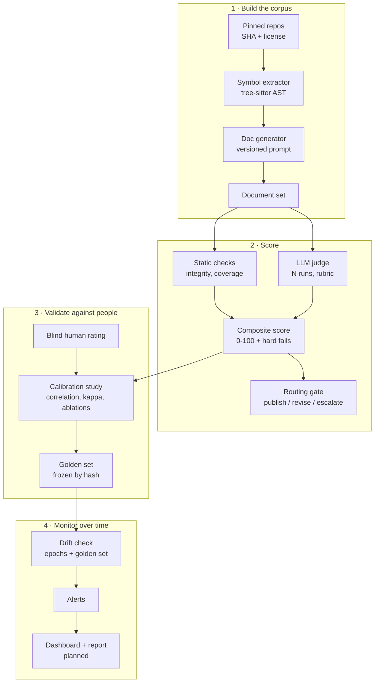

# Assay

**Measure whether LLM-written documentation is actually good, prove the measure agrees with people, and get alerted when quality drifts.**


Assay is an open, reproducible evaluation harness for LLM-generated technical documentation. It scores generated docs for code with a composite of deterministic checks and an LLM judge, validates that score against blind human ratings, and monitors it over time so a model or prompt change cannot quietly degrade output.

> **Status: pilot.** The pipeline runs end to end, from pinned repositories to calibration and drift checks, on a pilot of two repositories (click and dataframely, 32 documents). Human ratings are in progress, so no result is reported yet: every target below is a hypothesis to be tested.

## Why

Teams ship generated text behind a quality gate that nobody has validated against human judgment, and they rarely notice when output gets worse. Assay exists to answer three questions with data:

1. Does an automated documentation-quality score **agree with human raters**?
2. Is it **stable enough** to gate publication?
3. Can it **detect regressions** when the model, prompt or inputs change?

## How it works



**Design principles**

- **Deterministic first.** Source facts are parsed before any LLM runs; checks compare generated text back to them.
- **The judge never stands alone.** Static checks anchor the judge, and critical failures reject a document regardless of score.
- **Humans calibrate, they do not operate.** People rate a sample to validate the scorer; they are not in the scoring path. Only raters listed in the config count as human; an LLM's ratings never stand in for them.
- **Everything is stamped.** Model id, prompt hash, data hash and package versions travel with every row.

## What gets measured

| Layer    | Metric                                                           | Type                                 |
| -------- | ---------------------------------------------------------------- | ------------------------------------ |
| Static   | Referential integrity: every technical name exists in the source | Deterministic                        |
| Static   | Symbol coverage and structural completeness                      | Deterministic                        |
| Static   | Readability                                                      | Deterministic                        |
| Judged   | Accuracy, clarity, consistency against a written rubric          | LLM judge, median of repeated runs   |
| Combined | Composite 0-100 with critical-failure rejection                  | Weighted, fit on a development split |

## Targets (hypotheses)

| Criterion                     | Target                                                        |
| ----------------------------- | ------------------------------------------------------------- |
| Composite vs human rating     | Spearman rho >= 0.70 on a held-out split                      |
| Judge vs human, per criterion | Weighted kappa >= 0.60                                        |
| Judge repeatability           | Same routing decision in >= 90% of repeated runs              |
| Drift sensitivity             | Injected degradation flagged within 3 epochs                  |
| Reproducibility               | Full results regenerate from one command with pinned versions |

Results will be reported with confidence intervals, including negative and null results. If a target is missed, the report says so.

## Quickstart

```bash
# Requirements: Python 3.12+, uv, and Ollama with the models named in config/default.yaml.
# Bedrock and OpenAI models are optional; their keys go in .env, which is never committed.
git clone https://github.com/salgue441/assay.git
cd assay
./scripts/setup-env.sh          # env + locked deps + .env (Windows: scripts\setup-env.ps1)

# Build and score the corpus (each command takes --repo and --epoch to narrow it)
uv run assay build-corpus       # clone pinned repos, extract symbols and units
uv run assay generate           # document sampled units with every subject model
uv run assay measure            # static checks
uv run assay judge              # rubric grades from every judge, N runs each
uv run assay score              # composite score and routing decision

# Validate against people
uv run assay rate --rater r1    # blind rating app; use a pseudonym, never your name
uv run assay calibrate          # agreement with the raters in evaluation.raters
uv run assay calibrate --test   # the held-out test split; meant to be run once
uv run assay judge-variance     # how much grades and routing move between judge runs
uv run assay judge-bias         # length bias and self-preference of every judge
uv run assay golden-set         # freeze rated development documents for monitoring

# Monitor
uv run assay drift-check        # later epochs vs the baseline, judge vs the golden set
```

Models, prompt versions, rubric version, weights, thresholds, raters and per-run budget caps live in `config/`. Reports and logs are written under the storage root (`data/` by default).

## Repository layout

```text
assay/
├── config/            # models, prompts, rubric, weights, thresholds, raters, budgets
├── data/              # Parquet tables, reports and logs (local; not in git)
├── scripts/           # environment setup and the local CI checks
├── src/assay/
│   ├── corpus/        # repo pinning, snapshots, units, license checks
│   ├── extract/       # tree-sitter symbol inventory for Python, TypeScript and Go
│   ├── generate/      # subject-model harness
│   ├── llm/           # Ollama, Bedrock and OpenAI clients
│   ├── metrics/       # plug-in static metrics behind one interface
│   ├── judge/         # rubric-driven LLM judge
│   ├── scoring/       # composite scorer and routing gate
│   ├── rating/        # blind human-rating app
│   ├── calibrate/     # calibration study, ablations, baseline, variance, golden set
│   ├── drift/         # drift statistics and the drift check
│   ├── storage/       # content-checked Parquet tables
│   └── orchestrate/   # Dagster assets, partitions and asset checks
└── tests/             # metric fixtures and pipeline tests
```

Still to come: the dbt marts (`transform/`), the dashboard and report, and the S3, DVC and Terraform setup (`infra/`).

## Methodology in brief

- **Split.** Development/test split by repository, balanced by language and unit kind; weights, routing thresholds and the baseline are chosen on development. Every evaluation of the test split is logged, and evaluating it again under a changed configuration is refused unless forced.
- **Calibration.** Spearman and Kendall correlation with bootstrap 95% intervals resampled by repository; Krippendorff's alpha across raters sets the ceiling on achievable agreement.
- **Judge checks.** Quadratic-weighted kappa per criterion; the spread of grades and routing decisions across repeated runs at temperature 0 and 0.7; length bias (rank correlation of grade with word count, controlling for the human grade once enough documents are rated); and self-preference (how much more a judge favours its own model family than a judge of another family does, unit by unit).
- **Ablations.** Each component, the judge and the critical-failure rule are removed in turn to show which parts earn their place.
- **Learned baseline.** Ridge and gradient-boosted models predict the human rating from static metrics and text features, with no LLM call, to measure how much of the judge's value they recover.
- **Drift.** KS test and PSI on score distributions, EWMA control charts per metric, a binomial test on the rejection rate, and a frozen golden set that separates "the subject model got worse" from "the judge drifted".

## Data and licensing

- Only public repositories with permissive licenses (for example MIT or Apache-2.0) are used; each snapshot stores its commit SHA and license.
- No proprietary, employer or confidential material is used anywhere in this project.
- Human raters appear under pseudonymous ids; no personal data is stored.
- Generated documents are published only for sources whose licenses allow it.

## Reproducibility

Every row records the model identifiers, prompt hash, rubric version, seeds and the content hashes it was derived from, and every table is checked against its contract on each read and write. CI runs formatting, lint, type checks and the test suite on Linux and Windows; `scripts/check.sh` runs the same checks locally, plus a security audit of the workflows. Versioning the data with DVC, rebuilding the report in CI and scheduled drift checks in GitHub Actions are planned.

## Roadmap

- [ ] **Pilot:** small end-to-end run to measure cost and labeling power _(gate: cost and power fit)_. The pipeline runs on two repositories; human ratings are in progress.
- [ ] **Corpus:** pin repositories, extract symbols, generate documents. Built; later epochs are still to be generated.
- [x] **Scorer:** static checks, LLM judge, composite and routing rules
- [ ] **Calibrate:** human ratings, analysis, frozen golden set _(gate: targets met or honestly reported)_. Analysis and golden set built; waiting on ratings.
- [ ] **Monitor:** drift check built; degradation injection, scheduled runs, alerts and the public write-up to come

## Contributing

Issues and pull requests are welcome, especially new metrics (they plug in behind a single `score(text, context) -> MetricResult` interface) and additional human raters. Please read `CONTRIBUTING.md` before opening a PR, and run `./scripts/check.sh` (or `scripts\check.ps1`) first.

## Citation

If you use Assay in research, please cite it using the metadata in `CITATION.cff`.

## License

[MIT](LICENSE) © Carlos Salguero
