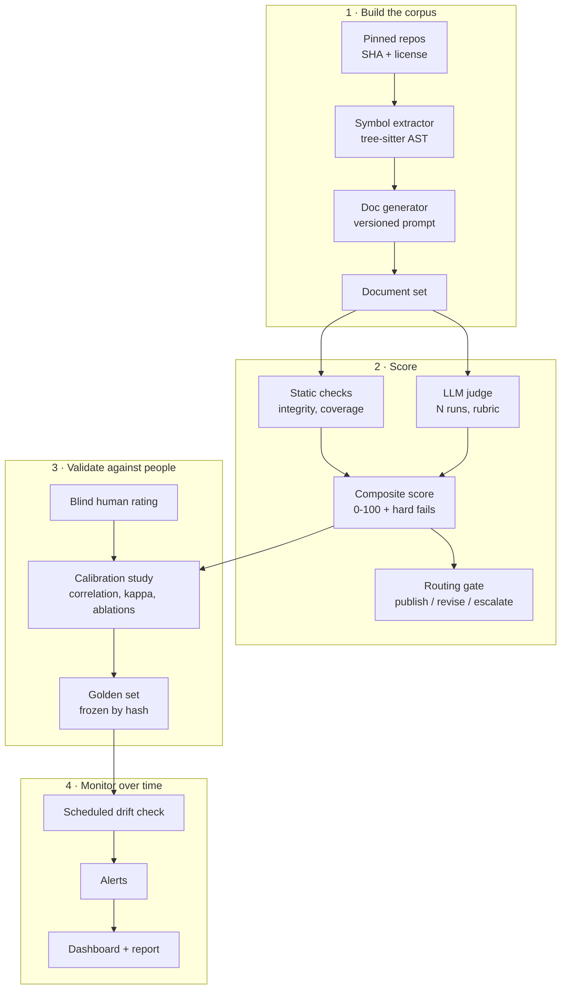

# Assay

**Measure whether LLM-written documentation is actually good, prove the measure agrees with people, and get alerted when quality drifts.**


Assay is an open, reproducible evaluation harness for LLM-generated technical documentation. It scores generated docs for code with a composite of deterministic checks and an LLM judge, validates that score against blind human ratings, and monitors it over time so a model or prompt change cannot quietly degrade output.

> **Status: design phase.** The architecture is specified (see [`docs/SAD.md`](docs/SAD.md)); implementation is starting. The commands in [Quickstart](#quickstart) describe the planned interface, and every target below is a hypothesis to be tested, not a result.

## Why

Teams ship generated text behind a quality gate that nobody has validated against human judgment, and they rarely notice when output gets worse. Assay exists to answer three questions with data:

1. Does an automated documentation-quality score **agree with human raters**?
2. Is it **stable enough** to gate publication?
3. Can it **detect regressions** when the model, prompt or inputs change?

## How it works



**Design principles**

- **Deterministic first.** Source facts are parsed before any LLM runs; checks compare generated text back to them.
- **The judge never stands alone.** Static checks anchor the judge, and critical failures reject a document regardless of score.
- **Humans calibrate, they do not operate.** People rate a sample to validate the scorer; they are not in the scoring path.
- **Everything is stamped.** Model id, prompt hash, data hash and package versions travel with every row.

## What gets measured

| Layer    | Metric                                                           | Type                                 |
| -------- | ---------------------------------------------------------------- | ------------------------------------ |
| Static   | Referential integrity: every technical name exists in the source | Deterministic                        |
| Static   | Symbol coverage and structural completeness                      | Deterministic                        |
| Static   | Readability                                                      | Deterministic                        |
| Judged   | Accuracy, clarity, consistency against a written rubric          | LLM judge, repeated runs             |
| Combined | Composite 0-100 with critical-failure rejection                  | Weighted, fit on a development split |

## Targets (hypotheses)

| Criterion                     | Target                                                        |
| ----------------------------- | ------------------------------------------------------------- |
| Composite vs human rating     | Spearman rho >= 0.70 on a held-out split                      |
| Judge vs human, per criterion | Weighted kappa >= 0.60                                        |
| Judge repeatability           | Same score band in >= 90% of repeated runs                    |
| Drift sensitivity             | Injected degradation flagged within 3 scheduled runs          |
| Reproducibility               | Full results regenerate from one command with pinned versions |

Results will be reported with confidence intervals, including negative and null results. If a target is missed, the report says so.

## Quickstart

> Planned interface. Not yet implemented.

```bash
# Requirements: Python 3.12+, uv, an API key for at least one LLM provider
git clone https://github.com/salgue441/assay.git
cd assay
uv sync

cp .env.example .env            # add provider keys; never commit .env

uv run assay build-corpus       # clone pinned repos, extract symbols
uv run assay generate           # produce documentation with the configured subject model
uv run assay score              # static checks + LLM judge + composite
uv run assay calibrate          # compare against human ratings
uv run assay drift-check        # re-score golden set + rolling sample
uv run assay report             # render the dashboard and written report
```

Models, prompt versions, rubric version, weights, thresholds and per-run budget caps live in `config/`.

## Repository layout (planned)

```text
assay/
├── config/            # models, prompts, rubric, weights, thresholds, budgets
├── data/              # DVC-tracked: sources, units, documents, ratings (Parquet)
├── docs/
│   └── SAD.md         # solution architecture document
├── src/assay/
│   ├── corpus/        # repo pinning, snapshotting, license checks
│   ├── extract/       # tree-sitter symbol inventory
│   ├── generate/      # subject-model harness
│   ├── metrics/       # plug-in metrics behind one interface
│   ├── judge/         # rubric-driven LLM judge
│   ├── score/         # composite scorer and routing gate
│   ├── rating/        # blind human-rating app
│   ├── calibrate/     # correlation, reliability, ablations, error analysis
│   ├── drift/         # drift tests and alerting
│   └── report/        # dashboard and report
└── tests/             # metric fixtures and pipeline tests
```

## Methodology in brief

- **Split.** Stratified development/test split by repository; weights and thresholds are chosen on development, and the test split is evaluated once.
- **Calibration.** Spearman and Kendall correlation with bootstrap 95% intervals; Krippendorff's alpha across raters sets the ceiling on achievable agreement.
- **Judge checks.** Quadratic-weighted kappa per criterion, within-document variance across repeated runs, and tests for length and self-preference bias.
- **Ablations.** Each component and the critical-failure rule are removed in turn to show which parts earn their place.
- **Drift.** KS test and PSI on score distributions, EWMA control charts per metric, and a frozen golden set that separates "the subject model got worse" from "the judge drifted".

Full detail is in [`docs/SAD.md`](docs/SAD.md).

## Data and licensing

- Only public repositories with permissive licenses (for example MIT or Apache-2.0) are used; each snapshot stores its commit SHA and license.
- No proprietary, employer or confidential material is used anywhere in this project.
- Human raters appear under pseudonymous ids; no personal data is stored.
- Generated documents are published only for sources whose licenses allow it.

## Reproducibility

Every run records the model identifiers, prompt hash, rubric version, data hashes, seeds and package versions. Datasets are content-hashed and versioned with DVC. CI rebuilds the report from stored results and runs unit tests for every metric against hand-built fixtures. Scheduled drift checks run in GitHub Actions.

## Roadmap

- [ ] **Pilot:** small end-to-end run to measure cost and labeling power _(gate: cost and power fit)_
- [ ] **Corpus:** pin repositories, extract symbols, generate documents
- [ ] **Scorer:** static checks, LLM judge, composite and routing rules
- [ ] **Calibrate:** human ratings, analysis, frozen golden set _(gate: targets met or honestly reported)_
- [ ] **Monitor:** scheduled drift checks, sensitivity tests, public write-up

## Contributing

Issues and pull requests are welcome, especially new metrics (they plug in behind a single `score(document, context) -> MetricResult` interface) and additional human raters. Please read `CONTRIBUTING.md` before opening a PR, and run `uv run pytest` and `uv run ruff check` first.

## Citation

If you use Assay in research, please cite it using the metadata in `CITATION.cff`.

## License

[MIT](LICENSE) © Carlos Salguero
